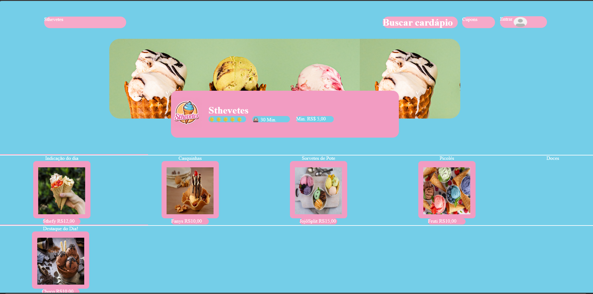
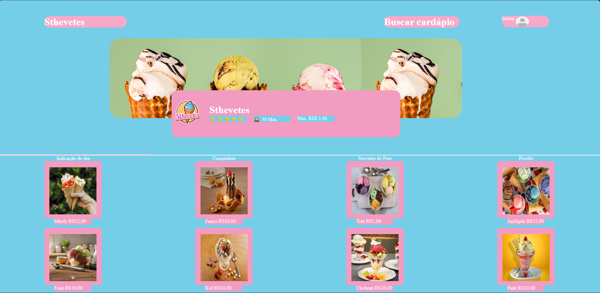
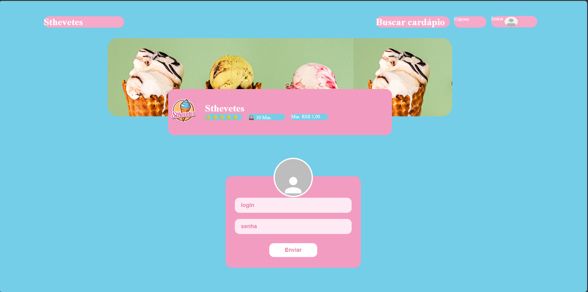

Professor(a):Josué Rodrigo Evangelista Figueiredo                           

Aluna (o): Sthefany Andrade Brito

Nome do Projeto: Sthevetes

Curso: Informática para a Internet

Turma: D

## Documentação - Sthevetes

1. **Apresentação do projeto**

O Sthevetes é um site onde se pode comprar dos mais variados tipos de sorvetes até os mais comuns, objetivando adoçar um pouco mais a vida de cada consumidor dos seus próprios lares. Destarte, o Sthevetes busca permitir o acesso ao sorvete de maneira acessível, barata e rápida, pois todos merecem se deliciar com um bom sorvete.

2. **Funcionalidades**

Ao adentrar no sistema o usuário consegue ter uma visão geral do que é possível fazer. Sendo possível executar o seguinte:
- Acessar o cardápio geral, ao clicar em “Buscar cardápio”;
- Fazer login, ao clicar em “Entrar”;
- Voltar para a tela inicial a qualquer momento, ao clicar em “Sthevetes”;

3. **Tecnologias utilizadas**

Para a produção do site do Sthevetes foram utilizadas as seguintes ferramentas: HTML5, CSS3, JavaScript, Visual Studio Code e muita criatividade.

4. **Estrutura do projeto**

Foi utilizada somente uma pasta para armazenar os arquivos com os códigos de cada tela. arquivos esses que são três:
- stevetes.html

Armazena todos os códigos da tela inicial;
- sthevetes2.html

Armazena todos os códigos da página onde é possível visualizar o cardápio do Sthevetes; 
- stevetes3.html

Armazena todos os códigos da página onde é possível efetuar o login;

5. **Como executar o projeto?**

Para acessar com sucesso o Sthevetes é necessário que a pessoa possua um computador com o Visual Studio Code instalado e ter os códigos de cada página do site. Tendo o código basta colocá-los em arquivos diferentes dentro do Visual Studio Code, após isso basta clicar em abrir com Live Server e prontinho.

6. **Demonstração do projeto**

Tela Inicial - ela permite que o usuário tenha um panorama geral do site e de como é possível navegar por ele.

Tela do cardápio - ao clicar em “buscar cardápio” em qualquer página o usuário é direcionado para essa página, onde é possível explorar a variedade de sorvetes disponíveis para a compra.

Tela de Login - ao clicar em “entrar” em qualquer página o usuário é direcionado para essa, onde é possível efetuar o login no site.

7. **Melhorias futuras**

Para o aperfeiçoamento do Sthevetes recomendaria a melhoria do design, ainda há alguns problemas no design que precisam ser solucionados, formatação para o celular, ainda há bugs e problemas com a formatação, acréscimo de funcionalidades, como tornar possível executar uma compra de fato.
